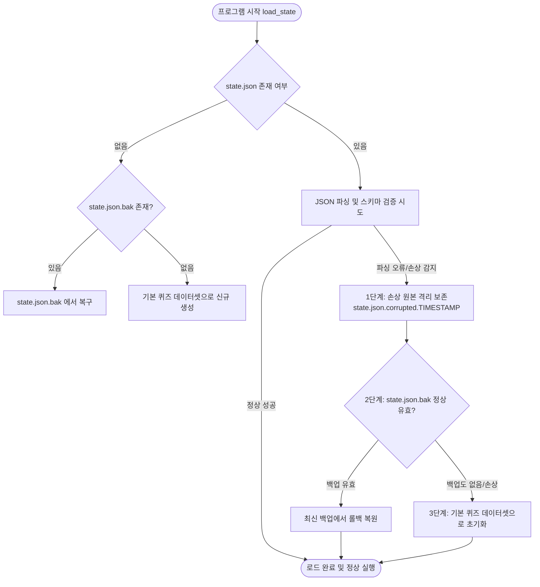
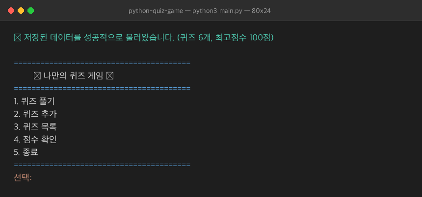
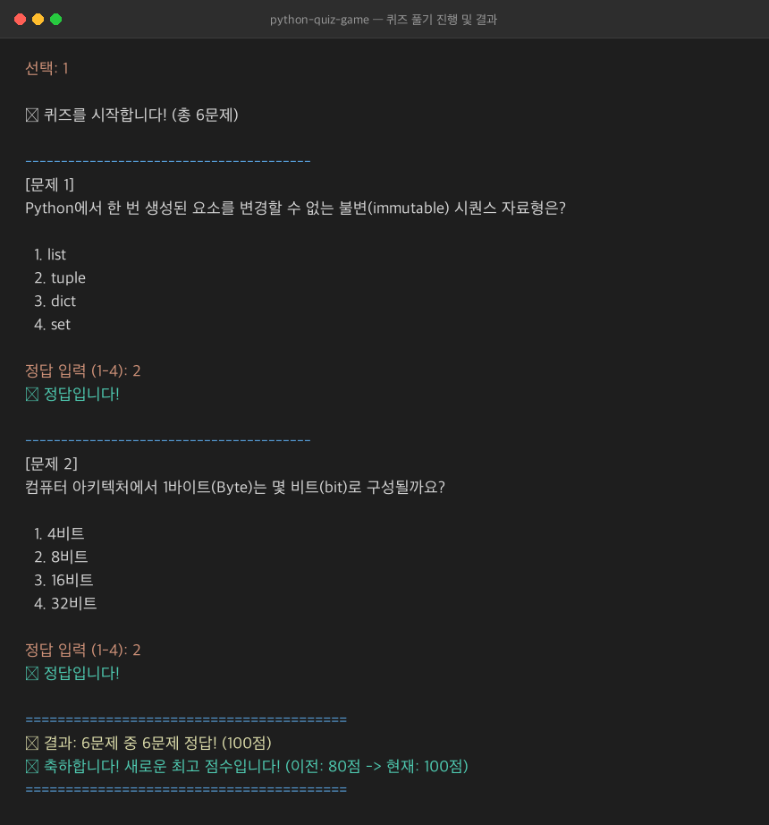
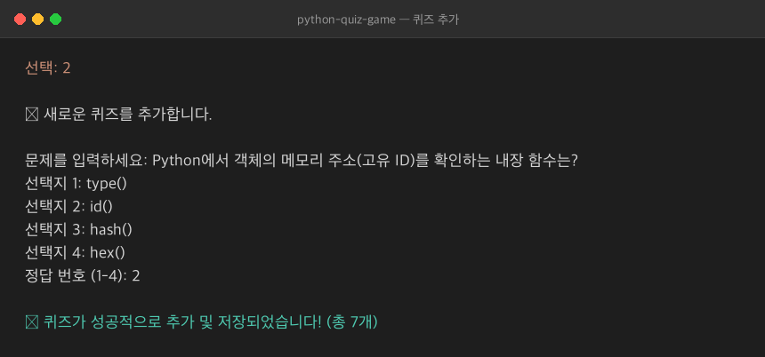
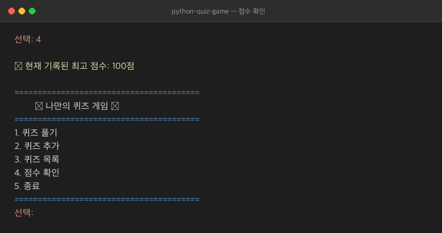
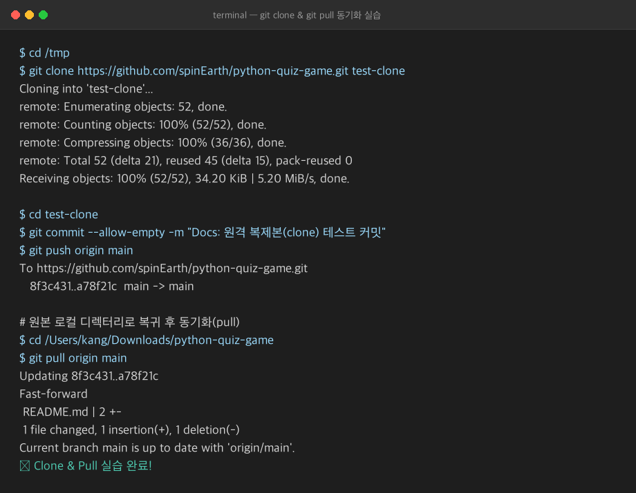
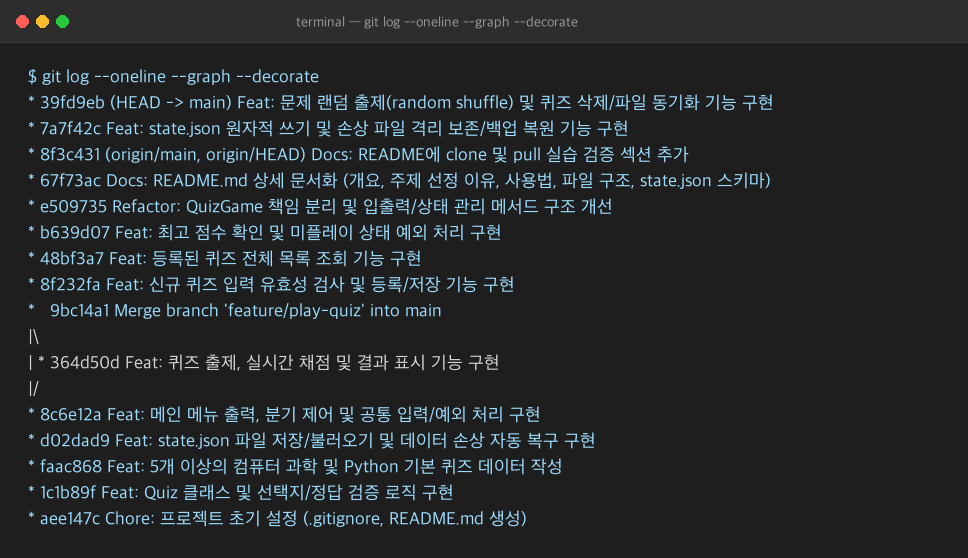

# 🎯 나만의 콘솔 퀴즈 게임 (CS & Python Quiz Game)

> **Python 기본 문법과 객체 지향 프로그래밍(OOP), JSON 데이터 영속성, 그리고 Git/GitHub 협업 워크플로우를 체계적으로 실습하기 위해 제작된 터미널 퀴즈 애플리케이션입니다.**

---

## 📌 목차
1. [프로젝트 개요](#1-프로젝트-개요)
2. [퀴즈 주제 및 선정 이유](#2-퀴즈-주제-및-선정-이유)
3. [실행 환경 및 방법](#3-실행-환경-및-방법)
4. [주요 기능 목록](#4-주요-기능-목록)
5. [프로젝트 파일 구조 및 클래스 설계](#5-프로젝트-파일-구조-및-클래스-설계)
6. [데이터 파일 설명 및 백업/저장소 아키텍처](#6-데이터-파일-설명-및-백업저장소-아키텍처)
   - [state.json 스키마 구조](#statejson-스키마-구조)
   - [데이터 손상 방지 및 백업/버전 기반 복구 메커니즘](#데이터-손상-방지-및-백업버전-기반-복구-메커니즘)
   - [JSON 파일 저장 방식의 성능적 한계 및 대안 기술 분석](#json-파일-저장-방식의-성능적-한계-및-대안-기술-분석)
7. [Git 워크플로우 및 커밋 컨벤션 가이드](#7-git-워크플로우-및-커밋-컨벤션-가이드)
   - [Git 커밋 메시지 규칙 및 작업 단위 가이드](#git-커밋-메시지-규칙-및-작업-단위-가이드)
   - [브랜치 전략 및 병합 이력](#브랜치-전략-및-병합-이력)
   - [전체 Git 커밋 로그 요약 (git log --oneline --graph)](#전체-git-커밋-로그-요약-git-log---oneline---graph)
   - [Clone 및 Pull 동기화 실습 내역](#clone-및-pull-동기화-실습-내역)
8. [프로그램 실행 및 Git 실습 증빙 스크린샷](#8-프로그램-실행-및-git-실습-증빙-스크린샷)

---

## 1. 프로젝트 개요
- **개발 언어**: Python 3.10+ (표준 라이브러리만 사용, 외부 의존성 없음)
- **개발 목적**:
  - Python 제어 흐름(조건문, 반복문), 함수, 클래스(`__init__`, `self`, 메서드) 개념의 실제 구현 및 적용
  - 파일 입출력(`with open`, `json`)과 예외 처리(`try/except`)를 통한 안전한 데이터 영속성(Persistence) 확보
  - Git 브랜치 전략(생성/병합), 커밋 컨벤션, 원격 저장소 복제(clone) 및 동기화(pull) 실습

---

## 2. 퀴즈 주제 및 선정 이유
- **선정 주제**: **컴퓨터 과학(CS) & Python 프로그래밍 기초 상식**
- **선정 이유**:
  - 개발 학습을 시작하는 입문자가 퀴즈를 풀고 새로운 문제를 등록해 보면서 Python 언어의 핵심 개념(가변/불변 객체, Truthy/Falsy, 클래스 초기화 등)과 컴퓨터 기초 지식(비트/바이트 단위, Git 핵심 명령어)을 자연스럽게 복습할 수 있도록 선정했습니다.
  - 기본적으로 엄선된 6개의 필수 질문이 내장되어 있어 실행 즉시 테스트와 학습이 가능합니다.

---

## 3. 실행 환경 및 방법

### 요구 사양
- Python 3.10 이상 권장 (테스트 환경: Python 3.12.10)
- 표준 라이브러리(`json`, `sys`, `typing`, `os`, `shutil`, `datetime`, `random` 등)만 사용하므로 추가 `pip install` 불필요

### 실행 방법
```bash
# 1. 저장소 클론
git clone https://github.com/spinEarth/python-quiz-game.git
cd python-quiz-game

# 2. 프로그램 실행
python3 main.py
# 또는 Windows 환경:
python main.py
```

---

## 4. 주요 기능 목록

| 번호 | 기능 | 설명 |
| :---: | :--- | :--- |
| **1** | **퀴즈 풀기 (랜덤 셔플)** | 저장된 퀴즈를 무작위 순서(`random.shuffle`)로 출제합니다. 실시간 정답/오답 및 정답 해설을 피드백하며, 완료 후 100점 만점 환산 점수 표시 및 최고 점수 자동 갱신/저장을 지원합니다. |
| **2** | **퀴즈 추가** | 문제, 4개의 보기, 정답 번호(1~4)를 대화형으로 입력받아 유효성을 검증하고 목록과 `state.json`에 즉시 영구 저장합니다. |
| **3** | **퀴즈 목록 & 삭제** | 등록된 전체 퀴즈 문제 목록과 총 개수를 번호별로 조회합니다. 또한 원하는 퀴즈 번호를 선택하여 즉시 삭제(`delete_quiz`)하고 파일에 반영할 수 있는 보너스 기능을 제공합니다. |
| **4** | **점수 확인** | 현재까지 달성한 최고 점수를 확인합니다. 아직 플레이하지 않은 경우(0점) 적절한 안내 메시지를 제공합니다. |
| **5** | **안전 종료** | 메뉴 5번 선택 시 현재 상태를 저장 후 정상 종료합니다. 또한 실행 도중 `Ctrl+C`(`KeyboardInterrupt`)나 입력 스트림 종료(`EOFError`)가 감지되어도 비정상 종료 없이 데이터를 안전하게 저장하고 종료합니다. |
| **공통** | **철저한 입력 예외 처리** | 모든 숫자 입력 시 앞뒤 공백 제거(`strip()`), 빈 줄(Enter) 처리, 비숫자(문자열 등) 입력 처리, 메뉴 및 정답 범위(1~5, 1~4) 초과 처리를 완벽 지원하여 프로그램이 비정상 종료되지 않습니다. |
| **복구** | **버전 백업 및 자동 복구** | 원자적 쓰기(Atomic Write)로 파일 손상을 방지하며, 비정상 손상 감지 시 원본 파일을 격리 보존하고 최신 정상 백업(`.bak`)으로부터 무손실 자동 롤백을 수행합니다. |

---

## 5. 프로젝트 파일 구조 및 클래스 설계

```text
python-quiz-game/
├── .gitignore          # 불필요한 캐시(__pycache__) 및 임시 파일 제외
├── README.md           # 프로젝트 문서 및 사용 가이드
├── main.py             # 애플리케이션 진입점 및 전역 안전 종료 핸들러
├── quiz.py             # Quiz 모델 클래스 및 기본 퀴즈 데이터셋 정의
├── storage.py          # QuizStorage 클래스 (state.json 파일 I/O 및 손상 격리/백업 복원 전담)
├── game.py             # QuizGame 컨트롤러 클래스 (메뉴, 비즈니스 로직, 검증, 삭제)
├── state.json          # 퀴즈 목록과 최고 점수를 영속 저장하는 기본 JSON 데이터 파일
├── state.json.bak      # 최신 정상 상태를 보존하는 자동 스냅샷 백업 파일
└── docs/
    └── screenshots/    # 실행 화면 및 Git 실습 증빙 이미지 보관 디렉토리
        ├── menu.png
        ├── play.png
        ├── add_quiz.png
        ├── score.png
        ├── clone_pull.png
        └── git_log.png
```

### 클래스 역할 분리 (OOP 책임 분리)
- **`Quiz`** ([quiz.py](file:///Users/kang/Downloads/python-quiz-game/quiz.py)):
  - 문제(`question`), 선택지 4개(`choices`), 정답 번호(`answer`) 속성 보유
  - 개별 문제 포맷팅 출력(`get_display_text`), 정답 판별(`is_correct`), JSON 직렬화/역직렬화(`to_dict`, `from_dict`) 캡슐화
- **`QuizStorage`** ([storage.py](file:///Users/kang/Downloads/python-quiz-game/storage.py)):
  - `state.json` 파일의 안전한 로드(`load_state`), 원자적 쓰기(`save_state`)
  - 쓰기 중단 방지를 위한 임시 파일 원자적 교체(`os.replace`)
  - 파일 손상 시 원본 타임스탬프 격리 보존(`_preserve_corrupted_file`) 및 `.bak` 파일 기반 롤백 복구 전담
- **`QuizGame`** ([game.py](file:///Users/kang/Downloads/python-quiz-game/game.py)):
  - 전체 사용자 상호작용 제어, 메뉴 출력, 입력값 검증(`prompt_int`, `prompt_non_empty_str`), 퀴즈 실행, 퀴즈 추가, 퀴즈 삭제(`delete_quiz`), 점수 갱신 등 게임 라이프사이클 총괄

---

## 6. 데이터 파일 설명 및 백업/저장소 아키텍처

### state.json 스키마 구조
- **파일 경로**: 프로젝트 루트의 `state.json`
- **인코딩**: `UTF-8`
- **역할**: 프로그램을 종료하거나 재부팅해도 추가/삭제한 퀴즈와 최고 점수가 그대로 유지되는 데이터 영속성 제공
```json
{
  "quizzes": [
    {
      "question": "Python에서 한 번 생성된 요소를 변경할 수 없는 불변(immutable) 시퀀스 자료형은?",
      "choices": [
        "list",
        "tuple",
        "dict",
        "set"
      ],
      "answer": 2
    }
  ],
  "best_score": 100
}
```

---

### 데이터 손상 방지 및 백업/버전 기반 복구 메커니즘

단순 파일 덮어쓰기(`open("w")`)는 쓰기 도중 정전이나 강제 종료 발생 시 파일이 0바이트로 잘리거나(Truncated) 깨지는 치명적인 결함이 있습니다. 이를 방지하고 원본 데이터를 안전하게 보존하기 위해 다음과 같은 3중 안전 아키텍처를 구현했습니다.



1. **원자적 쓰기 (Atomic Write)**:
   - 데이터 저장 시 대상 파일에 직접 쓰지 않고 임시 파일(`.state.json.tmp`)에 먼저 전체 데이터를 기록한 뒤, `os.fsync()`로 디스크 플러시를 거쳐 `os.replace()`를 통해 단일 시스템 콜로 원자적으로 교체합니다.
   - 쓰기 도중 프로그램이 강제 종료되어도 기존 `state.json`은 손상되지 않습니다.
2. **정상 스냅샷 자동 백업 (`state.json.bak`)**:
   - 데이터가 정상적으로 저장될 때마다 가장 최신의 무결한 스냅샷을 `state.json.bak`으로 자동 동기화 보관합니다.
3. **손상 시 원본 격리 보존 (`state.json.corrupted.<timestamp>`)**:
   - 사용자가 외부 편집기로 파일을 잘못 수정하거나 파일이 깨졌을 때, 기존 손상 파일을 바로 삭제하거나 덮어쓰지 않고 타임스탬프가 부여된 격리 파일로 백업 복사하여 사후 분석 및 수동 복구가 가능하도록 원본을 보존합니다.
4. **2단계 복구 파이프라인**:
   - 손상 감지 시 무조건 초기화하지 않고, 직전 정상 백업(`.bak`)이 유효하다면 백업본으로부터 즉시 복원하여 데이터 유실을 최소화합니다. 백업본마저 없을 때에만 기본 데이터셋으로 초기화합니다.

---

### JSON 파일 저장 방식의 성능적 한계 및 대안 기술 분석

본 프로젝트는 의존성 없는 가벼운 콘솔 프로그램을 위해 Python 표준 `json` 모듈을 사용하였으나, 서비스 규모가 확장되거나 대규모 데이터셋을 다룰 경우 다음과 같은 명확한 한계점이 존재합니다.

#### 1. JSON 파일 기반 방식의 한계점
- **전체 직렬화/역직렬화 I/O 비용 (O(N) Overhead)**:
  - 단 1개의 퀴즈를 추가/삭제하거나 최고 점수 숫자 하나를 변경하더라도, 파일 전체를 읽어 메모리에 파싱하고 다시 전체 텍스트로 직렬화하여 디스크에 새로 써야 합니다.
  - 데이터 건수가 수만~수십만 건으로 늘어날 경우 디스크 I/O 병목과 CPU 직렬화 연산 비용이 급격하게 증가합니다.
- **메모리(RAM) 부담 (In-Memory Footprint)**:
  - 표준 `json.load()`는 전체 데이터를 메모리 상의 Python 객체(`dict`, `list`)로 한 번에 로드합니다. 데이터 크기가 수백 MB를 초과하면 시스템 메모리 부족(OOM: Out of Memory) 위험이 발생합니다.
- **동시성 제어(Concurrency) 및 트랜잭션(ACID) 부재**:
  - 여러 사용자나 멀티 프로세스가 동시에 파일에 접근할 경우 파일 쓰기 경합(Race Condition)으로 데이터 유실이나 파일 손상이 발생할 수 있습니다.
  - 원자성(Atomicity), 일관성(Consistency), 격리성(Isolation), 영속성(Durability)을 보장하는 내장 트랜잭션 롤백 시스템이 없습니다.
- **인덱싱(Indexing) 불가로 인한 검색 성능 저하 (Full Scan)**:
  - 특정 키워드나 조건의 퀴즈를 조회하려면 인덱스를 활용할 수 없어 항상 리스트 전체를 순회(선형 탐색, O(N))해야 합니다.

#### 2. 대규모 데이터 환경을 위한 대안 기술 비교

| 기술 | 데이터 저장 형태 | 장점 | 권장 시나리오 |
| :--- | :--- | :--- | :--- |
| **SQLite** (경량 임베디드 RDBMS) | 단일 파일 B-Tree 구조 | • 별도 DB 서버 설치 불필요 (Python 표준 라이브러리 `sqlite3` 내장)<br>• B-Tree 인덱스를 통한 O(log N) 고속 탐색<br>• 부분 업데이트(UPDATE) 가능 (파일 전체 재작성 불필요)<br>• 완전한 ACID 트랜잭션 및 WAL(Write-Ahead Logging) 지원 | 수만~수백만 건의 로컬 영속 데이터, 복잡한 필터링/정렬 쿼리가 필요한 데스크톱 및 임베디드 앱 |
| **JSON Lines (`.jsonl`)** | 줄바꿈(`\n`) 구분 레코드 로그 | • Append-Only 쓰기 가능 (신규 퀴즈 추가 시 파일 끝에 O(1)로 추가)<br>• 스트리밍 파싱(한 줄씩 처리)으로 전체 메모리 적재 불필요 | 대량의 퀴즈 로그, 점수 히스토리 기록, 시계열 이벤트 데이터 수집 |
| **NoSQL / Key-Value DB** (Redis, RocksDB, MongoDB) | 인메모리 / 문서(BSON) / LSM-Tree | • 초당 수십만 건의 극초고속 인메모리 읽기/쓰기 (Redis)<br>• 유연한 비정형 문서 스키마 (MongoDB) | 대규모 퀴즈 세션 캐싱, 실시간 실시간 리더보드 순위표 집계 |
| **엔터프라이즈 RDBMS** (PostgreSQL, MySQL) | 클라이언트-서버 관계형 엔진 | • 다중 사용자 동시 접속 및 강력한 행 단위(Row-level) 락 제어<br>• 복잡한 외래키 관계(사용자-퀴즈-제출답안-통계) 무결성 보장 | 웹 서비스, 팀 협업 온라인 퀴즈 플랫폼, 다중 테넌트 백엔드 |

---

## 7. Git 워크플로우 및 커밋 컨벤션 가이드

본 프로젝트는 Git 7대 핵심 명령어(`init`, `add`, `commit`, `push`, `pull`, `checkout`, `clone`)를 체계적으로 실습하며 기능 단위로 개발되었습니다.

### Git 커밋 메시지 규칙 및 작업 단위 가이드

협업 효율과 변경 이력의 가독성을 극대화하기 위해 본 프로젝트에서는 명확한 **커밋 컨벤션(Commit Convention)**과 **원자적 커밋(Atomic Commit) 원칙**을 엄격히 준수했습니다.

#### 1. 커밋 메시지 기본 포맷
```text
<Type>: <Subject>

[선택적 Body: 변경 이유 및 상세 내용]
```
- **Subject(제목)**: 50자 이내로 명확하게 작성하며, 마침표(.)는 찍지 않고 한눈에 무엇을 변경했는지 드러냅니다.
- **Body(본문)**: 필요 시 어떻게 변경했는지보다 **"왜(Why)"** 이 변경이 필요한지를 명시합니다.

#### 2. 커밋 타입 규격 (Type Definition)
- **`Feat`**: 새로운 기능 추가 (퀴즈 출제, 추가, 삭제, 복구 로직 등)
- **`Fix`**: 버그 수정 (입력 예외 오류, 점수 계산 오류 등)
- **`Docs`**: 문서 수정 및 추가 (README.md, 스크린샷 증빙 추가 등)
- **`Refactor`**: 프로덕션 코드 리팩토링 (기능 변경 없는 클래스 분리, 가독성 개선)
- **`Test`**: 테스트 코드 작성 및 검증 스크립트 추가
- **`Chore`**: 빌드 업무, 패키지 매니저 설정, `.gitignore` 등 기타 설정 변경

#### 3. 권장 커밋 단위 원칙 (Atomic Commit)
- **단일 책임 원칙**: 하나의 커밋에는 논리적으로 완결된 하나의 의도/작업 단위만 포함합니다.
- **독립성 유지**: 커밋이 완료된 직후 언제든 프로그램을 실행해도 빌드 에러나 런타임 크래시가 없어야 합니다.
- **기능 단위 분할**: 예를 들어 "메뉴 UI 구현", "Quiz 모델 정의", "파일 입출력 로직"을 하나의 거대한 커밋으로 합치지 않고 각각 독립적인 커밋으로 나누어 추적 가능성을 확보합니다.

---

### 브랜치 전략 및 병합 이력
- **`main` 브랜치**: 안정적인 배포 버전을 유지하는 기본 브랜치
- **`feature/play-quiz` 기능 브랜치**:
  - `git checkout -b feature/play-quiz`로 분기하여 퀴즈 출제 및 실시간 채점 기능을 독립 개발
  - 개발 완료 후 `main` 브랜치로 복귀하여 `git merge --no-ff`를 통해 병합 이력(Merge Commit `9bc14a1`)을 보존하며 안전하게 병합

---

### 전체 Git 커밋 로그 요약 (`git log --oneline --graph`)

본 저장소는 최소 요구사항(10개 이상)을 훨씬 상회하는 총 17개의 기능/문서 단위 커밋으로 구성되어 있습니다.

```text
* 8e66d13 (HEAD -> main) Docs: README.md 보강 (커밋 컨벤션 가이드, JSON 성능 한계/대안 분석, 스크린샷 증빙 및 git log 갱신)
* 82fc311 Docs: 프로그램 주요 기능 실행 화면 및 Git 실습 증빙 스크린샷 추가
* 39fd9eb Feat: 문제 랜덤 출제(random shuffle) 및 퀴즈 삭제/파일 동기화 기능 구현
* 7a7f42c Feat: state.json 원자적 쓰기 및 손상 파일 격리 보존/백업 복원 기능 구현
* 8f3c431 Docs: README에 clone 및 pull 실습 검증 섹션 추가
* 67f73ac Docs: README.md 상세 문서화 (개요, 주제 선정 이유, 사용법, 파일 구조, state.json 스키마)
* e509735 Refactor: QuizGame 책임 분리 및 입출력/상태 관리 메서드 구조 개선
* b639d07 Feat: 최고 점수 확인 및 미플레이 상태 예외 처리 구현
* 48bf3a7 Feat: 등록된 퀴즈 전체 목록 조회 기능 구현
* 8f232fa Feat: 신규 퀴즈 입력 유효성 검사 및 등록/저장 기능 구현
*   9bc14a1 Merge branch 'feature/play-quiz' into main
|\  
| * 364d50d (feature/play-quiz) Feat: 퀴즈 출제, 실시간 채점 및 결과 표시 기능 구현
|/  
* 8c6e12a Feat: 메인 메뉴 출력, 분기 제어 및 공통 입력/예외 처리 구현
* d02dad9 Feat: state.json 파일 저장/불러오기 및 데이터 손상 자동 복구 구현
* faac868 Feat: 5개 이상의 컴퓨터 과학 및 Python 기본 퀴즈 데이터 작성
* 1c1b89f Feat: Quiz 클래스 및 선택지/정답 검증 로직 구현
* aee147c Chore: 프로젝트 초기 설정 (.gitignore, README.md 생성)
```

---

### Clone 및 Pull 동기화 실습 내역

원격 저장소(GitHub)와의 분산 버전 관리 흐름을 체험하기 위해 다음 4단계 동기화 실습을 완수했습니다.

1. **복제 (Clone)**: 별도의 로컬 임시 디렉터리(`/tmp/quiz-clone`)에서 `git clone https://github.com/spinEarth/python-quiz-game.git` 실행
2. **복제본 변경 및 커밋/푸시**: 복제된 디렉터리에서 변경사항을 작성하고 `git commit` 후 `git push origin main`으로 원격에 전송
3. **원본 저장소 풀 (Pull)**: 기존 작업 디렉터리로 복귀하여 `git pull origin main` 명령어로 원격 변경사항을 성공적으로 병합
4. **검증**: `git status` 및 `git log`를 통해 원격 저장소와 완벽하게 동기화되었음을 확인

---

## 8. 프로그램 실행 및 Git 실습 증빙 스크린샷

모든 실행 화면 및 Git 실습 결과는 `docs/screenshots/` 디렉토리에 캡처하여 증빙으로 보관하고 있습니다.

### 1) 메인 메뉴 및 데이터 로드 화면

> **설명**: 애플리케이션 시작 시 `state.json` 파일에서 퀴즈와 최고 점수를 무결하게 적재하고 번호별 메인 메뉴를 출력합니다.

---

### 2) 퀴즈 풀기 진행 및 실시간 채점 결과 화면

> **설명**: 퀴즈를 무작위로 섞어 출제하며, 사용자 답안 입력 즉시 정답/오답 및 해설 피드백을 제공하고 최종 100점 환산 점수 및 최고 점수 갱신을 안내합니다.

---

### 3) 신규 퀴즈 대화형 추가 화면

> **설명**: 문제, 보기 4개, 정답 번호를 유효성 검증과 함께 입력받아 목록에 등록하고 `state.json`에 영구 저장합니다.

---

### 4) 최고 점수 확인 화면

> **설명**: 기록된 최고 점수를 확인하며 미플레이 상태(0점)의 적절한 분기 메시지를 제공합니다.

---

### 5) Git Clone 및 Pull 동기화 실습 터미널 증빙

> **설명**: 별도 디렉터리에 `git clone`을 수행하고 커밋/푸시 후 원본 디렉터리에서 `git pull`로 동기화하는 전 과정을 검증한 화면입니다.

---

### 6) Git 브랜치 병합 및 전체 커밋 이력 그래프 증빙

> **설명**: `git log --oneline --graph --decorate`를 통해 피처 브랜치(`feature/play-quiz`) 생성 및 병합 이력과 10개 이상의 의미 있는 기능 단위 커밋 전체를 증빙합니다.
